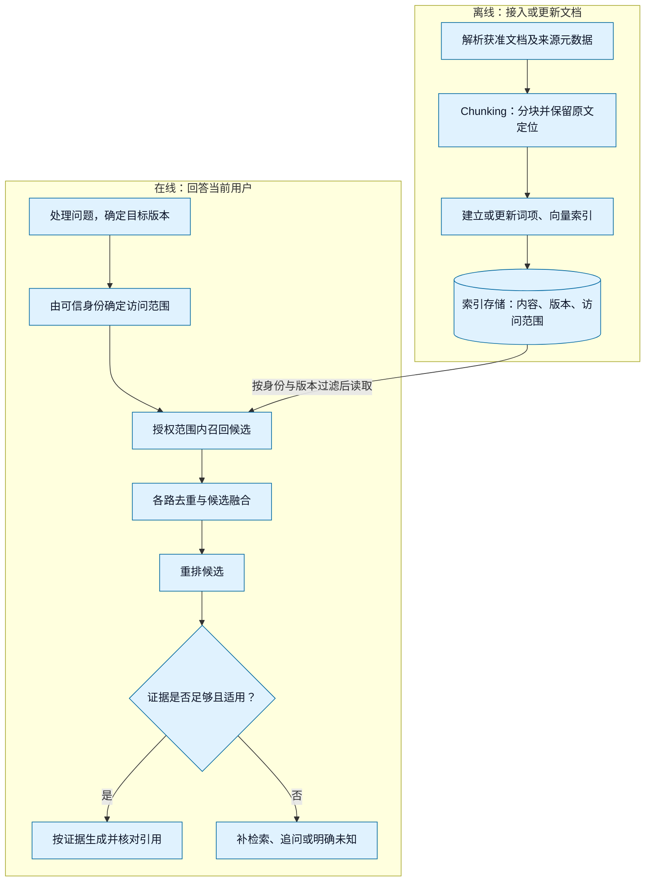

# 第3章 用户记忆、知识库与 RAG

本章继续用技术文档查询理解检索：“DemoServe 1.0 默认监听哪个端口，怎样修改？请给出来源。”下面的 DemoServe、文档和候选排名均为**合成教学材料**，不对应真实产品或检索实测。

假设知识库中，A 是 1.0 版配置说明，写有“默认端口 9000，可通过 `--port` 修改监听端口”；B 是同版本启动示例，写有“使用 `--port 9100`，让服务监听端口 9100”；C 是其他版本的参数说明；D 是需要额外权限的内部运维记录，另有不相关的公开文档 X/Y。目标是找到当前用户可访问、版本适用的 A/B，用它们解释参数；C 不能混作 1.0 依据，D 不能因相似度高就泄露。

## 3.1 上下文、用户记忆与知识库的分工 {#_3-1-context、memory、knowledge-base-是三层不同概念}

| 概念                     | 作用                    | 生命周期               | 典型内容                 |
| ------------------------ | ----------------------- | ---------------------- | ------------------------ |
| Context（上下文）        | 本次推理实际看见什么    | 单次模型调用及当前任务 | 指令、对话、检索片段     |
| Memory（用户记忆）       | 跨会话维护个人/任务经验 | 多会话、长期           | 已确认偏好、任务历史     |
| Knowledge Base（知识库） | 共享领域事实和资料      | 按版本长期维护         | 文档、业务规则、代码规范 |

RAG（Retrieval-Augmented Generation，检索增强生成）是让模型在回答前**检索有依据的外部信息**的流程，不等于存储系统本身；既可以连接知识库，也可以服务于个人记忆。

在这个例子里，Knowledge Base（知识库）保存版本化技术资料；Memory（用户记忆）可以保存已确认的“偏好中文解释并附命令”这样的习惯；Context（上下文）则包含当前问题、相关偏好和本轮取出的文档片段。LLM（Large Language Model，大语言模型）看到的是这次输入的内容，而非自动看到整个库。

## 3.2 用户记忆的分类

- **情景记忆（Episodic Memory）**：谁在何时做了什么，依赖事件上下文。
- **语义记忆（Semantic Memory）**：从多条事实抽象的稳定知识或偏好。
- **程序记忆（Procedural Memory）**：执行某类任务的步骤或技能经验。

按保存颗粒度，还可区分：原始轨迹、精炼事实、关联卡片、任务状态。原书比较 Simple Notes、Enhanced Notes、JSON Cards 与 Advanced JSON Cards，强调从简单原子事实向关联结构演进时，表达力上升、维护成本也上升。

示意卡片【实践补充】：

```json
{
  "fact_id": "f-001",
  "subject": "project",
  "predicate": "preferred_report_format",
  "value": "markdown",
  "source": "confirmed_user_preference",
  "observed_at": "2026-10-22",
  "confidence": 0.95,
  "expires_at": null
}
```

**注意**：`confidence=0.95` 只是应用自行定义的元数据，不代表天然经过概率校准。个人信息保存还要有最小化、过期、纠错、删除、权限及审计策略。

上述报告格式属于语义记忆的一个例子；“上次查询了哪份 1.0 文档”更接近情景记忆，“确认版本→检索→读正文→附来源”则可沉淀为程序记忆。这三类描述信息用途，不要求采用三种固定数据库。

## 3.3 记忆的读取与整理

建议设计四条管线：

1. **提取候选**：从交互中识别“长期有用且有权限保存”的信息。
2. **去重/冲突**：与旧记忆比较，处理更正、时效与来源。
3. **检索与注入**：只选择当前任务需要的记忆，避免长期常驻全部细节。
4. **复核与清理**：按时间衰减、显式更正、反馈迭代。

存储内容并非越精简越好，复杂关系可能需要结构化表示；但无论采用何种形式，都不能将模型推测当作已证实的用户事实。

### 一条偏好从候选到清理

下面是记忆生命周期的教学设计，不是 Mem0 或 Memobase 的通用内置行为：

| 阶段       | 用户或系统输入                               | 应保存或执行什么                                                                           |
| ---------- | -------------------------------------------- | ------------------------------------------------------------------------------------------ |
| 候选       | 用户在一次回答中要求“这次附命令”             | 先服务当前任务，不自动推断成永久偏好                                                       |
| 确认与写入 | 用户明确要求“以后技术解释默认用中文并附命令” | 记录用户身份、偏好范围、来源、确认状态、时间与有效期；保存最少必要信息                     |
| 读取       | 新问题查询 DemoServe 配置                    | 只注入相关的表达偏好，技术参数仍从对应版本文档检索                                         |
| 更正       | 用户改为“默认只解释，需要时再给命令”         | 更新有效版本，旧记录标为已替代，后续检索不再注入旧偏好                                     |
| 冲突       | 旧偏好要求附命令，当前任务要求“不要给命令”   | 在本次任务按明确的新要求输出；是否改变长期默认，需根据用户意图另行确认                     |
| 清理       | 用户要求删除偏好，或记录过期                 | 从后续可检索内容及相应索引中移除，缓存和备份按既定保留策略处理；保留合规所需的最小审计信息 |

其他人的文档写着“用户喜欢执行命令”，不能成为该用户的确认来源。记忆也不授予执行权限；“偏好附命令”只影响回答形式。

### 记忆系统与评估：Mem0、Memobase、LoCoMo {#mem0、memobase、locomo}

Mem0 / Memobase 是记忆系统案例，LoCoMo 用于长对话记忆评估。理解这类系统可沿写入、冲突处理、检索、删除和任务评估五个环节展开；记忆条数反映存储规模，任务表现则需要单独评价。

## 3.4 标准 RAG 流程

[RAG 检索、生成与结果验证流程](/assets/notes/ai-agent/03-rag.svg)

### 先建索引，再回答查询

索引（Index）是帮助定位内容的数据结构，通常在文档接入或变更时建立；查询阶段使用它寻找候选。两条链路需要分开：

| 阶段     | 输入与动作                                                                       | 产物                                                                   |
| -------- | -------------------------------------------------------------------------------- | ---------------------------------------------------------------------- |
| 文档索引 | 读取获准资料，解析正文，按结构分块；保存来源、版本、访问范围，建立词项与向量索引 | 能从块标识反查原文的索引；分块与模型版本也需要记录                     |
| 用户查询 | 确认用户身份和问题范围，检索授权内容；融合、重排、检查依据，把片段与引用交给模型 | 有出处的候选答案，以及引用核查结果；证据不足时继续检索、追问或明确未知 |


离线链路把资料变成可检索、可更新的索引，在线链路按当前用户的身份和版本条件读取它。图中的索引存储连接两阶段；更新文档时也要更新或失效相应索引。下图是教学架构，不表示上游 CLI 已实现授权和生成。原有 `03-rag.svg` 继续用于本章末尾的混合检索说明。[放大查看两阶段 SVG](/assets/notes/ai-agent/03-rag-two-stage.svg)。

<details>
<summary>查看两阶段总览的 Mermaid 图源</summary>



</details>

对 A/B，可以先保存“DemoServe、1.0、配置说明/启动例子、段落标识、内容哈希与可访问范围”，再建索引。回答问题时按身份与目标版本取得片段；文档更新后同步更新或失效旧索引，不能只改正文而长期引用旧块。

### 分块 Chunking

Chunking（分块）将文档拆成可检索片段；Embedding（嵌入）将文本编码为用于相似度比较的向量。分块影响可检索的内容单位，嵌入影响语义表示，二者要分别配置。

- 固定长度：实现容易，但可能切断事实上下文。
- 按 Markdown/标题/段落：更有利于保持文档结构。
- 递归分块：按章节→段落→句子逐层细化。
- 父子块：小块负责召回，大块提供上下文，兼顾定位和解释。

分块设计必须与问题类型匹配。例如函数级代码检索更适合符号/文件层级索引，而不是单纯按 500 字符截断。

### Dense / Sparse / Hybrid

BM25（Best Matching 25）是一类基于词项的相关性打分方法，考虑匹配词、频率、文档长度等因素；Sparse Retrieval（稀疏检索）以词项匹配等稀疏表示检索。Dense Retrieval（稠密检索）比较学习得到的向量表示，Hybrid Retrieval（混合检索）组合多路候选。Rerank（重排）则对已召回的较小候选池再次评分。Cross-Encoder（交叉编码器）联合处理查询与候选文本来评分。

| 技术   | 代表              | 擅长                         | 可能的短板                  |
| ------ | ----------------- | ---------------------------- | --------------------------- |
| Dense  | 向量余弦相似度    | 语义近似和同义表达           | 精确编号/专有名词可能漏召回 |
| Sparse | BM25 等           | 代码符号、版本号、精确关键词 | 改写与语义表达较弱          |
| Hybrid | BM25 + Dense      | 兼顾精确和语义               | 融合策略需评测              |
| Rerank | Cross-Encoder/LLM | 对少量候选精排               | 成本和延迟更高              |

典型顺序是召回 TopK → 合并去重 → 重排 TopN → 注入模型；**Rerank 不能修复召回阶段完全漏掉的文档。**

TopK 表示保留排名前 K 个候选，不表示它们都相关。对本章文档，可用三个查询观察不同需求：

| 查询                         | 需要匹配什么                   | 待验证的检索假设                                       |
| ---------------------------- | ------------------------------ | ------------------------------------------------------ |
| `DemoServe 1.0 --port`       | 项目名、版本和精确参数         | BM25 有机会保留精确词项；分词若拆坏参数也会影响效果    |
| “怎样让服务换一个监听入口？” | 与“修改监听端口”之间的语义联系 | Dense 可能帮助召回同义表述，但需模型支持相应语言与领域 |
| “1.0 版默认端口与启动例子”   | 版本约束和来自 A/B 的互补证据  | Hybrid 汇总候选，版本和权限仍须按明确规则处理          |

这些是设计预期，不是三条查询的实测排名。向量相似不等于版本正确，精确匹配也不等于内容足够。

### 授权、版本和引用如何跟随片段

授权范围应在检索层落实，并在重排、交给外部模型和输出前按需要复核。先检索全库再删答案中的敏感词，会让无权内容提前进入后续组件。D 即使排在第一位，也不能交给无权用户或未经授权的模型服务；示例 `evaluate.py` 的本地语料流程不等于实现了这套权限机制。

每条候选至少应可追溯到文档/块标识、来源版本、原文位置和内容校验值，答案的具体断言应对应支持它的片段。哈希能识别内容，不能证明作者可信或授予读取权限。若 A/B 没有某项参数，或只有其他版本的 C，应明确证据不足并限定版本，不能凭模型印象补出答案；检索片段中的指令也不能改变系统权限。

### 沿着一条问题走到带引用的答案

仍以开头的合成材料为例。下表的候选排名由教学案例指定，未运行 Dense、重排器或回答模型；它用于解释信息怎样流动，不是性能或效果测量。

| 步骤           | 输入                                         | 处理                                                       | 输出                                                                                     |
| -------------- | -------------------------------------------- | ---------------------------------------------------------- | ---------------------------------------------------------------------------------------- |
| 用户问题       | “DemoServe 1.0 默认监听哪个端口，怎样修改？” | 提取产品、版本和“默认值／修改方式”两个待回答点             | 查询目标为 DemoServe 1.0；不能删掉版本条件                                               |
| 查询处理       | 原问题与目标版本                             | 保留 `--port` 等精确词项，可补充“监听端口／启动示例”       | BM25 查询词与 Dense 查询文本，另带版本过滤条件                                           |
| 身份与版本过滤 | 服务端确认的用户身份、索引元数据             | 排除其他版本 C 和当前用户无权访问的 D，再决定可检索集合    | 只在 A/B/X/Y 中检索；D 不进入重排器或回答模型                                            |
| 两路召回       | 查询及授权范围内的索引                       | 示意 BM25 得到 `[A,B,X]`，Dense 得到 `[B,A,Y]`             | 两路带文档／块标识的候选，而非答案                                                       |
| 融合与重排     | 两路候选                                     | 各路先去重，RRF 融合；A/B 同分时用明确规则或重排器继续比较 | 示例保留 A/B，并回查其原文；排序领先不证明事实正确                                       |
| 证据检查       | A 的配置说明、B 的启动示例                   | 检查产品、1.0 版本、来源位置及原文是否支持每项结论         | A 支持默认 9000 和修改参数；B 支持 `--port 9100` 的示例                                  |
| 生成及核对     | 问题、已验证片段和来源标识                   | 只表达有依据的结论，并逐项核对引用                         | “1.0 默认端口为 **9000**〔A〕；用 **`--port`** 修改〔A〕，例如 **`--port 9100`**〔B〕。” |

这里的〔A〕和〔B〕是合成语料的来源标识，实际系统应能展开到相应版本、原文段落和可访问地址。B 的例子不能反过来证明默认端口是 9100；C 即使语义更近，也不支持 1.0 的结论。如果 A/B 缺失，就在对应结论处说明证据不足，而不是把最高相似度候选当成事实。

## 3.5 结构化组织与智能体检索

- **RAPTOR（Recursive Abstractive Processing for Tree-Organized Retrieval，面向树形检索的递归抽象处理）**：按层次聚合并摘要，便于从细节到主题层级检索。
- **图增强RAG / GraphRAG**：广义方法用实体、关系或图结构组织检索；不同项目并非同一实现。若特指 Microsoft GraphRAG，还应区分实体周围的 local search 与依靠社区报告的 global search。后者用于“全库主要主题是什么”一类跨全数据集汇总；“某实体关联了哪些对象”更接近局部检索问题。社区发现、报告生成与更新均有成本。依据：[Microsoft GraphRAG Global Search](https://microsoft.github.io/graphrag/query/global_search/)（2026-10-22核查，项目特定机制，不泛化到全部图RAG）。
- **文件系统范式 / OpenViking**：利用目录层次、文件引用、按需查看实现渐进式知识发现；适合 Agent 具有 read/grep/list 等工具的场景。
- **Agentic RAG（智能体式检索增强生成）**：模型判断“需不需要检索、换不换关键词、证据够不够”，可能多轮搜索，但引入更高成本与失败风险。
- **Contextual Retrieval（上下文增强检索）**：在索引时为原本脱离章节语境的块附加相关背景，有助于减少语义断裂。例如给“使用 `--port`”补上该块所属的产品、版本和章节。这与“把用户记忆摘要放到每次查询前”是不同的处理环节，不应混为一谈。

对小型配置问答，先把分块、版本、权限和引用做清楚即可；需要全库主题汇总或复杂跨文档关系时，再评估上述结构。若要核对 RAPTOR 的具体实现，应从 [原论文](https://arxiv.org/abs/2401.18059) 开始，不把不同框架的同名术语当成相同实现。

## 3.6 RAG 的评价指标与诊断

检索指标的唯一主定义见 [第6章：单查询RR与跨查询MRR](/articles/ai-agent-evaluation.html#retrieval-metrics)。本章使用同一口径：前5名为 `[X,A,Y]`、相关集合为 `{A,B}` 时，Hit@5=1、Recall@5=0.5、RR@5=0.5。只有这一题时MRR也为0.5；不要把单查询的首次相关排名或RR直接称为MRR。

这里的 A/B 可以对应本章两份相关文档，X/Y 为不相关文档；虽然截断上限为 5，系统只返回了三个候选。手算如下，仍沿用第 6 章的定义：

- **Hit@5（前五命中）**：命中至少一份相关文档，取 1。
- **Recall@5（前五召回率）**：命中了 A，共 1 份；全部相关文档有 A/B 两份，故为 1/2。
- **RR@5（Reciprocal Rank，截断倒数排名）**：第一个相关结果 A 排第 2，故为 1/2。
- **MRR@5（Mean Reciprocal Rank，平均截断倒数排名）**：对多条有效查询的 RR 求平均。再加一题，首次命中在第 1 位，则两题 MRR 为 `(1/2 + 1) / 2 = 0.75`。

计算前固定相关标注、权限/版本范围、去重规则和评价单位：按块还是按原文档。在文档级评价中，同一文档的多个重叠块不能重复增加召回；按块评价则需对应的块级标注。没有相关文档的“无答案”问题单列，别把空标注当成普通漏召回。

排障时，先确认正确文档是否进入候选池，再检查融合与重排是否改善了它的位置，最后独立验证回答正确性、证据支持与引用准确性。端到端还应记录任务完成率、p95时延、检索/重排用量、过期信息和权限违规情况。检索得分高，并不能替代生成阶段的验证。

## 3.7 工程实验

以 Agent 开发文档问答为任务，做三个版本：BM25-only、Dense-only、Hybrid+Rerank。固定问题集，包含精确符号、同义词、跨文件关系和不存在的答案；比较 Recall@5、引用准确率与 p95 延迟。再引入“未找到可信依据则明确未知”的策略。

为区分融合与重排的贡献，实际对照还应保留 **Hybrid、不重排** 这一组。可按下面的步骤建立最小验证：

1. 保存 A/B/C/D 的合成内容、版本和权限标注，定义精确参数、同义改写、跨文档与无答案查询；提前写明允许引用哪些资料。
2. 用相同分块、语料和问题运行 BM25、Dense、Hybrid、Hybrid+Rerank；版本/权限过滤规则相同，每次只改变待比较组件。
3. 保存每路候选标识、融合分数、重排位置、最终引用和失败原因。相关文档未召回时，先修索引、分块或召回，而非只调重排器。
4. 增加无答案、跨版本和无权访问用例，检查系统能否保持未知或拒绝。索引能过滤不代表完整授权链已经验收。
5. 重复多次，分别统计召回、回答及引用正确性、权限违规、各阶段与端到端延迟。p95 是第 95 百分位数，需要固定采样窗口；本章不报告未经测量的耗时或提升幅度。

### 最小 BM25 实验：先验证输入、输出与指标

先运行不加载模型的稀疏检索。以下为 PowerShell 步骤，起点是**当前知识库仓库根目录**，Python 使用独立虚拟环境。上游工作目录必须是固定提交的 `chapter3/retrieval-pipeline`，其中 `evaluate.py` 会导入同目录的 `fusion.py`。

```powershell
python -m venv .tools/rag-demo-venv
& ./.tools/rag-demo-venv/Scripts/Activate.ps1
python -m pip install rank-bm25==0.2.2 jieba==0.42.1

$notesRoot = (Get-Location).Path
git clone https://github.com/bojieli/ai-agent-book.git .tools/ai-agent-book-rag
git -C .tools/ai-agent-book-rag checkout --detach dbc046eb896ac4e39aa19c7774c8bf49583b89a6
$corpus = Join-Path $notesRoot 'examples/ai-agent/ch3-rag/corpus.json'
$queries = Join-Path $notesRoot 'examples/ai-agent/ch3-rag/queries.json'
Set-Location .tools/ai-agent-book-rag/chapter3/retrieval-pipeline
python evaluate.py --no-dense --no-rerank --device cpu --top-k 5 --eval-k 5 --corpus "$corpus" --queries "$queries" --output bm25.json
```

若上述临时目录已存在，先确认其用途及 Git 版本，或换一个空目录，勿覆盖别的实验。语料文件是对象数组，字段为 `doc_id` 和 `text`；本仓库提供 A/B/X/Y 四条合成资料，例如 A 的对象为：

```json
{"doc_id": "A", "text": "DemoServe 1.0 配置说明：默认端口 9000，可通过 --port 修改监听端口。"}
```

问题文件也是数组，每项使用 `query` 和相关文档列表 `expected`。本实验只有一题，标注 A/B 均相关：

```json
[
  {"query": "DemoServe 1.0 默认端口 启动示例 --port", "expected": ["A", "B"], "category": "synthetic-config"}
]
```

C/D 在准备语料时已经排除：这是模拟一个已确定访问范围的数据集，**不是 CLI 在执行真实身份认证或访问控制**。问题已经改写为检索词，也不是调用模型改写的结果。

运行后先检查 `bm25.json` 是否生成，再读取其真实字段：

```python
import json

with open("bm25.json", encoding="utf-8") as stream:
    report = json.load(stream)
row = report["per_query"][0]
ranked = [item["doc_id"] for item in row["methods"]["sparse"]["top"]]
gold = set(row["expected"])
recall5 = len(set(ranked[:5]) & gold) / len(gold)
print(ranked, recall5, row["methods"]["sparse"]["recall@k"])
```

手算时只数返回前五名中出现的不同相关文档，再除以 A/B 两份相关文档的总数。比如只返回 A，Recall@5 就是 `1/2=0.5`；返回 A/B 则是 `2/2=1`，不相关 X/Y 不增加分子。以实际 JSON 为准，不能因示例只有四份文档就假定系统一定召回 A/B；该版本 BM25 实现会过滤非正分候选。

本次在 Python 3.12 的独立环境中，以配套语料和上面的参数实际执行 BM25，输出排名为 `[B,A]`，因此 Recall@5 为 `2/2=1`，与 JSON 的 `recall@k` 一致。这只说明这一个合成问题的检索结果，不是中文检索的通用效果结论。

| 现象                                              | 先检查什么                           | 如何归因                                                |
| ------------------------------------------------- | ------------------------------------ | ------------------------------------------------------- |
| `ModuleNotFoundError: rank_bm25`、找不到 `fusion` | 当前 Python 环境、依赖及脚本工作目录 | 环境或准备错误，尚未得到检索质量结论                    |
| JSON 解析失败、缺少 `doc_id`／`query`             | UTF-8 文件和上述输入结构             | 数据契约错误，不是算法“理解不了中文”                    |
| 程序完成，但 A/B 漏召回                           | 分词、词项、分块、候选数及原文       | 检索或数据设置问题，读取排名和分数后再定位              |
| 检索正确，但答案混入 C 的参数                     | 版本过滤和回答引用检查               | 完整问答链路问题；本 CLI 不生成答案，不能由它证明已修复 |

该版本输出包含 `config`、`summary`、`per_query`、`elapsed_sec`、`eval_k`。其中名为 `mrr` 的单题字段调用的是未按 `--eval-k` 截断的 `reciprocal_rank()`；它不能不加区分地标成本文定义的 RR@5。这里选 Recall@5 手算，保留第 3.6 节的指标定义。

Dense 对照不使用不存在的 `--dense-only` 参数。具备所需本地模型后，按第 3.8 节的 `--no-rerank` 命令保留两路检索，在 `per_query[].methods.dense.top` 查看 **Dense 融合前**的前五结果，在 `summary.dense` 查看该路汇总。`top` 只保存前五项；若评价更大的截断范围，需额外导出完整阶段排名。不要将 RRF 或重排结果当成 Dense-only，也不要将整次进程耗时当成 Dense 单阶段耗时。本次只验证 BM25 路径，未下载或运行 Dense／重排模型。

## 3.8 混合检索中的排名融合 {#_3-8-用混合检索源码补齐-融合-这一步}

优先读 `retrieval-pipeline/fusion.py`。RRF（Reciprocal Rank Fusion，倒数排名融合）不直接相加 BM25 分数和余弦相似度，而按每路排名贡献 `w / (k + rank)`。这避免了量纲不同的问题；`k=60` 是示例默认值，不是针对你的语料验证过的最优值。

源码节选（上下文依赖见原文件）：[chapter3/retrieval-pipeline/fusion.py](https://github.com/bojieli/ai-agent-book/blob/dbc046eb896ac4e39aa19c7774c8bf49583b89a6/chapter3/retrieval-pipeline/fusion.py#L83-L91)。

```python
weights = weights or {}
fused: Dict[str, float] = {}

for source, ranked in ranked_lists.items():
    weight = weights.get(source, 1.0)
    for rank, (doc_id, _score) in enumerate(ranked, start=1):
        fused[doc_id] = fused.get(doc_id, 0.0) + weight * (1.0 / (k + rank))

return sorted(fused.items(), key=lambda kv: kv[1], reverse=True)
```

输入需保证同一路列表中的每个文档只出现一次。这段实现逐项累加得分，因此上游若在同一路重复返回同一文档，就会重复加分。另一个实现 `weighted_score_fusion()` 会先对每路做 min-max 归一化；只有一个候选或所有分数相等时，归一化结果设为 1。理解这些退化情形，比仅记住融合公式更有帮助。

### k=60 的手算与重复候选

RRF 的 `k` 是平滑常数，区别于“取前 K 个候选”或评测截断位置。对文档 d，汇总出现过它的各路列表：`score(d) = Σ_source w_source / (60 + rank_source(d))`；排名从 1 开始，未出现的一路贡献为 0。

给定**人工指定的排名**：BM25 为 `[A,B,X]`，Dense 为 `[B,A,Y]`，两路权重均为 1。假设这些候选均是用户可读的公开资料，其他版本的 C 和无权访问的 D 已从本次范围排除。

| 候选 | BM25 贡献 | Dense 贡献 | 总分（约） |
| ---- | --------- | ---------- | ---------- |
| A    | 1/61      | 1/62       | 0.032522   |
| B    | 1/62      | 1/61       | 0.032522   |
| X    | 1/63      | 0          | 0.015873   |
| Y    | 0         | 1/63       | 0.015873   |

A/B 并列、X/Y 并列，分数并列不代表语义完全相同。最终展示次序还需明确并列规则，不能把输入顺序造成的先后解释为检索优势。

如果 BM25 输入误为 `[A,A,B]`，该实现会给 A 同时加上第 1、2 位贡献；再加 Dense 第 2 位，A 得到约 `0.048652`。在同一路先按候选 ID 去重，再重新确定排名，才能避免这次重复计分。**跨路出现同一候选的贡献相加是融合设计，同路重复计分是输入质量问题。** 若检索单位是块，需先明确候选 ID 是块 ID 还是文档 ID，不能误删同文档的不同有效块。

再换一组人工排名：BM25 为 `[A,B,X]`，Dense 为 `[B,Y,A]`，两路权重仍为 1、平滑常数仍为 60：

| 候选 | BM25 排名 | Dense 排名 | 融合得分（约）           |
| ---- | --------- | ---------- | ------------------------ |
| A    | 1         | 3          | `1/61 + 1/63 = 0.032266` |
| B    | 2         | 1          | `1/62 + 1/61 = 0.032522` |
| X    | 3         | 未出现     | `1/63 = 0.015873`        |
| Y    | 未出现    | 2          | `1/62 = 0.016129`        |

因此明确顺序为 **B → A → Y → X**：B 在两路都靠前，累计贡献最大。这里每路召回 TopK 为 3；公式中的 `k=60` 控制排名贡献的平滑程度；Recall@5 等指标里的 `@5` 则限定评价前五名，三者作用不同。融合排序仍不证明文档内容可信。

本轮用固定文件中的纯 Python 融合函数和上述合成列表核对手算及重复现象，没有加载检索模型；具体记录另存于本地验收资料。

### 推荐实验：型号、同义改写与漏召回

仓库自带相邻产品型号与自然语言查询。先在 `chapter3/retrieval-pipeline` 运行 `python evaluate.py --no-dense --no-rerank --output bm25.json` 建立稀疏基线；再分别启用 Dense、RRF、Rerank，并使用相同的语料、问题、chunk 参数和评测 k。

每条查询保留两路候选 ID、融合后排名、重排后排名与相关标注。再故意让正确文档不进入候选池，验证“重排不能补回漏召回”。首次加载 Dense/Rerank 仍可能下载模型；无 API Key 不等于无需联网或无需模型资源。单进程 CLI 和微服务路径的默认模型可能不同，应以实际参数为准。

固定版本 [evaluate.py 参数入口](https://github.com/bojieli/ai-agent-book/blob/dbc046eb896ac4e39aa19c7774c8bf49583b89a6/chapter3/retrieval-pipeline/evaluate.py#L650-L712)支持下面的命令。CLI（Command-Line Interface，命令行接口）是单进程评估路径，不必先启动 HTTP 微服务；以下为对照入口；本次实际运行的是第 3.7 节的自定义语料 BM25 路径，未运行 Dense 或重排命令：

```text
python evaluate.py --no-dense --no-rerank --eval-k 5 --output bm25.json
python evaluate.py --no-rerank --eval-k 5 --output hybrid.json
python evaluate.py --eval-k 5 --output rerank.json
python evaluate.py --query "XR-7003" --no-dense --no-rerank
```

这几条默认使用上游内置语料，不是本章 DemoServe 材料；自定义时可用 `--corpus` 与 `--queries`，格式见参数帮助。`--eval-k 5` 显式对齐本章评价截断；`--k-rrf` 控制融合常数，二者互不替代。默认流程可输出不同阶段结果，再抽取 Dense-only 等对照，不能把全流程耗时当作单阶段耗时。

[依赖文件](https://github.com/bojieli/ai-agent-book/blob/dbc046eb896ac4e39aa19c7774c8bf49583b89a6/chapter3/retrieval-pipeline/requirements.txt)包含 `rank-bm25`、`jieba`，以及 PyTorch、Transformers、句向量与重排模型相关包；README 另提供根包 `ch3` 可选依赖和锁定环境路线。声明列表可读不等于已在本机安装兼容。BM25 路径无需加载 Dense/Rerank 模型，但仍需要 Python 依赖；模型路径首次可能下载权重，`--offline` 只限制读取本地模型缓存，不能创造缺失的模型或依赖。

源码中关闭 Dense 后也会关闭重排；CLI 默认嵌入模型为 `sentence-transformers/all-MiniLM-L6-v2`、重排模型为 `BAAI/bge-reranker-base`，是否适合中文问题应独立测量。上游 README 也描述了多服务部署，不能把那条路径的准备工作、模型或历史结果直接当成本次 CLI 的本地运行证据。

这个 CLI 评估检索与排序，不直接完成本章的用户记忆、权限控制和回答生成。要验证第 3.7 节的完整问答，还需接入这些组件，并分别检查检索依据与最终回答。

[](/assets/notes/ai-agent/03-rag.svg)

图中展示稀疏与稠密检索、候选融合及生成验证的衔接；检索不到依据时保留失败或未知出口。[放大查看 SVG](/assets/notes/ai-agent/03-rag.svg)。[原始 DOT 语义图源](/assets/notes/ai-agent/03-rag.dot)供对照，不是本版配图的可编辑源文件。

若要继续研究记忆，下一步看 `chapter3/user-memory` 的记忆表示，再按[本站第6章的评价方法](/articles/ai-agent-evaluation.html)比较相同问题。表示复杂度上升是否有收益，需要通过召回与最终答案分开验证。

### 源码与实验入口

- [chapter3/retrieval-pipeline/README.md](https://github.com/bojieli/ai-agent-book/blob/dbc046eb896ac4e39aa19c7774c8bf49583b89a6/chapter3/retrieval-pipeline/README.md)
- [chapter3/user-memory/README.md](https://github.com/bojieli/ai-agent-book/blob/dbc046eb896ac4e39aa19c7774c8bf49583b89a6/chapter3/user-memory/README.md)
- [当前仓库正文](https://github.com/bojieli/ai-agent-book/blob/dbc046eb896ac4e39aa19c7774c8bf49583b89a6/book/chapter3.md)
- [实验优先级与复现记录](/articles/ai-agent-source-experiments.html)

## 本章要点 {#检查理解}

1. 记忆与知识库组织不同生命周期和作用范围的信息，RAG 则是读取这些信息并辅助生成的流程。
2. BM25 擅长精确关键词，Dense 擅长语义近似，因此错误码等精确符号应单独纳入检索测试。
3. 召回负责把依据放进候选池，生成负责正确使用依据，两阶段需要分别评估。
4. Contextual Retrieval 在索引阶段为分块附加背景；用户记忆注入属于另一条处理管线。
5. 长期记忆应记录来源、确认状态与有效期，并支持更正和删除，避免把模型推断保存成已确认事实。

## 学习资料与代码出处

本篇为个人学习整理，参考李博杰《深入理解 AI Agent：设计原理与工程实践》及 [ai-agent-book](https://github.com/bojieli/ai-agent-book/tree/dbc046eb896ac4e39aa19c7774c8bf49583b89a6)。代码节选保留正文中的固定提交链接，引用代码沿用上游 [Apache-2.0 许可证](/licenses/ai-agent-book-APACHE-2.0.txt)，不适用本站 CC0 声明。
